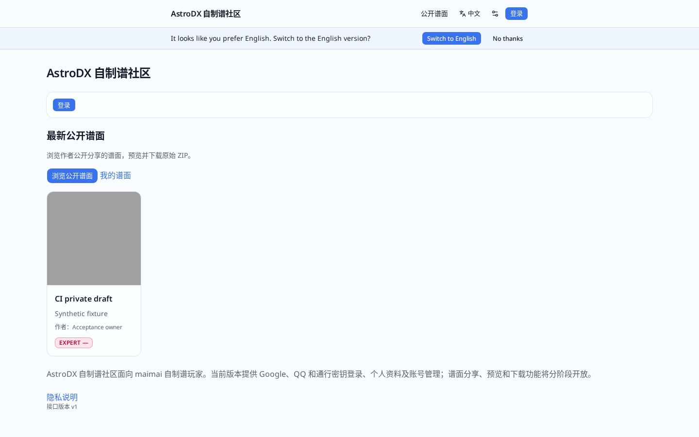
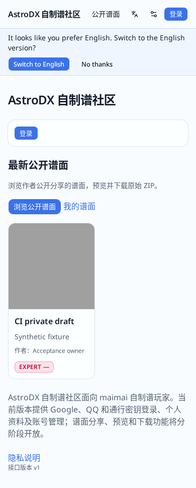
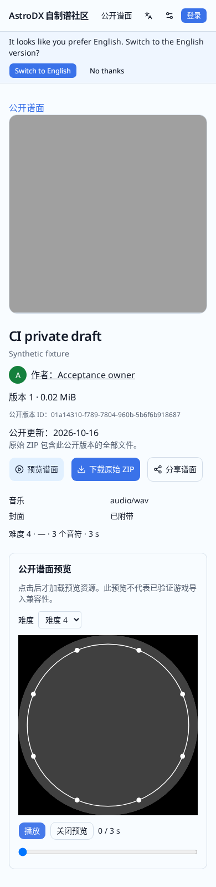

# Public publishing and chart browsing polish — 2026-10-16

## Implemented

- The homepage shows the latest six currently public charts using the public API. Each navigation fetches fresh, no-store public data; outages and an empty catalog have different messages. Account/meta behavior remains separate.
- Homepage and catalog reuse square-cover cards and the web main site's responsive grid and difficulty palette. Difficulty names are visible as well as colored, raw imported levels are preserved, and missing covers/unsupported previews stay explicit.
- Public details have visible preview, original ZIP download and share actions with touch targets. The preview shortcut focuses the named preview region without fetching maidata/audio or the engine until the user loads it.
- Sharing uses the localized public pathname, excluding query strings/fragments. Native cancellation never copies; clipboard missing/denied exposes a selected, readonly manual-copy field and restores focus when closed. Copied status follows a successful write only.
- Authors see private/published/unconfirmed status, the public version ordinal and whether their private draft differs. Updating still requires explicit version selection and archive consent. Uncertain journal state or lost write plus failed read cannot show an old definitive public/private state or automatically retry a write.
- Chinese, Japanese and English messages are updated together. Existing public snapshot, withdrawal, asset authorization and database/storage contracts remain intact.

## Verification

Application source: `176bc52792dc34acb45fed25a1e8680dad009e7f` (three development commits on `codex/community-public-polish`). The final report commit does not change application code.

- Relevant baseline: 8 homepage Bun tests and 24 public/editor DOM tests passed before changes.
- RED/GREEN: homepage current feed, empty/failure distinction, fresh reads after withdrawal and difficulty names; detail actions and sharing; private/public divergence, explicit update consent, pending/missing durability flag; publish/withdraw write response plus follow-up read both lost.
- Final isolated remote `bun run check && bun run build && bun run test:http`: lint, three-language generation, route types and TypeScript passed; **929 Bun tests passed, 1 opt-in WAL test skipped**, **99 DOM tests passed**, production build passed, **53 built-server HTTP tests passed**. The deliberate WAL-delay case is not counted as a new run in this UI pass.
- Independent whole-branch review identified one material status-display issue. Its reproducing tests failed first; the fix includes local reconciliation in the unconfirmed state and hides stale definitive information. The reviewer confirmed that finding resolved.

## Browser evidence

The built application and actual media/control roles passed the complete **14-step Chromium flow in 77.996 seconds**, with zero page errors and zero hydration errors:

- Real `.adx`, `.zip` and separately selected chart/audio/artwork uploads, processing, explicit save and reload.
- Author publication, published ordinal and private/public divergence; explicit consent remains required.
- Anonymous homepage → catalog → detail; a wide desktop grid and no horizontal overflow at 320/390 px.
- Focusable preview shortcut with no early maidata/audio request, then actual Canvas loading/play/pause and byte-exact original ZIP download.
- Actual Chromium clipboard write/read of the public pathname; manual fallback and focus with clipboard capability disabled. Native OS sharing is covered by interaction tests rather than a physical-device acceptance claim.
- Locale SSR/data behavior, withdrawal denial for old GET/HEAD/Range/conditional resource URLs, and client navigation home after withdrawal without the old card.
- Missing optional media/unsupported difficulty, deletion/quota release and avatar regression.

Continuous observation covered **120.937 seconds and 130 samples** through explicit shutdown, including the complete browser flow. All HTTP/PG/role/container/cgroup failure counts were zero, with no observation gaps, role-session changes, restart or OOM. Maximum sample gap was 0.960 seconds and maximum role-heartbeat age was 0.498 seconds. Application tail logs were retained through shutdown. All owned containers/volumes were removed; the dedicated 512 MiB disk image was normally unmounted and deleted, and the scoped sudo session was invalidated.

[Browser result](community-public-polish-2026-10-16/browser-result.json) · [Runtime observation](community-public-polish-2026-10-16/polish-stability.json)

## Boundaries

All installation, compilation, container services and Chromium run on the dedicated Linux builder. Tests use synthetic accounts and isolated databases/object storage. This development pass does not deploy production.

Native system share panels, actual mobile hardware and listening/game import are separate from desktop Chromium and viewport checks. Share API behavior follows [Navigator.share](https://developer.mozilla.org/en-US/docs/Web/API/Navigator/share) and [Clipboard.writeText](https://developer.mozilla.org/en-US/docs/Web/API/Clipboard/writeText), with cancellation and permissions covered in focused interaction tests.
